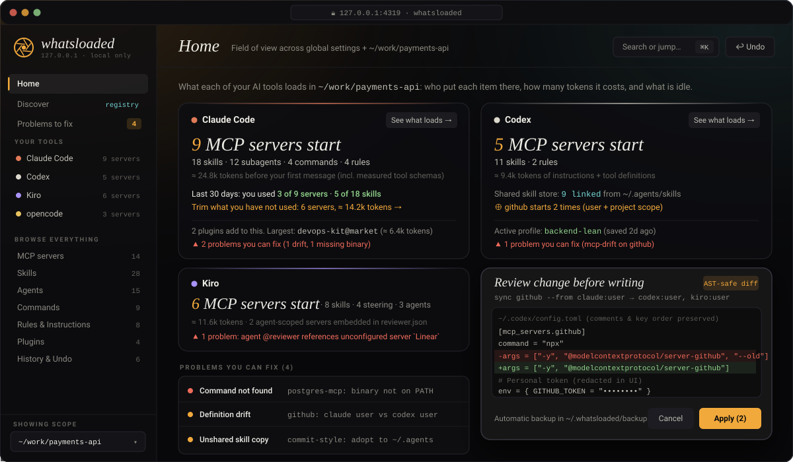
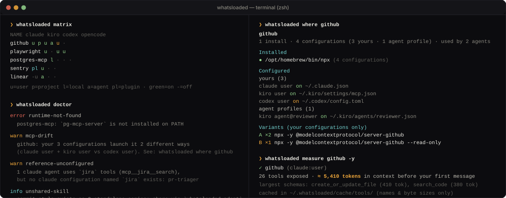

<div align="center">
  
  <h1>whatsloaded</h1>
  <p><strong>See what your AI coding agents load, what it costs in context tokens, what's broken, and what is idle.</strong></p>
  <p>
    <a href="https://github.com/bvamc/whatsloaded/actions/workflows/ci.yml"></a>
    <a href="LICENSE"></a>
    = 22.12" />
    
  </p>
</div>

<p align="center">
  
</p>

One local-first dashboard, TUI, and CLI for **Claude Code**, **Codex CLI**, **Kiro**, **opencode**, and the shared `~/.agents` skill store. Every change previews an exact diff and can be reverted with `whatsloaded undo`.

## Quick Start

```bash
git clone https://github.com/bvamc/whatsloaded.git
cd whatsloaded
npm install && npm run build && npm link
```

```bash
whatsloaded ui        # open local web dashboard (http://127.0.0.1:4319)
whatsloaded tui       # launch interactive terminal UI
whatsloaded doctor    # find drift, missing binaries, broken refs & duplicates
whatsloaded ls --here # include current project's configs (.mcp.json, .claude/, ...)
```

## CLI at a Glance

<p align="center">
  
</p>

### Inspect & Measure

| Command                        | Description                                                                                                    |
| :----------------------------- | :------------------------------------------------------------------------------------------------------------- |
| `whatsloaded ls [kind]`        | List MCP servers, skills, agents, commands, rules, and plugins (`--here` adds current project).                |
| `whatsloaded matrix [kind]`    | Cross-tool grid showing where each item is defined (`u`=user, `p`=project, `l`=local, `a`=agent, `pl`=plugin). |
| `whatsloaded where <server>`   | Trace binary on `PATH`, every config grouped by role, launch variants, and which agents use it.                |
| `whatsloaded doctor`           | Catch config drift, missing commands, unconfigured agent tool references, shadowing, and broken links.         |
| `whatsloaded measure <server>` | Start a server once (after confirmation) to measure its tool count and context token cost.                     |
| `whatsloaded show <query>`     | Full details with `env`/headers masked (pass `--reveal` to unmask).                                            |

### Manage, Sync & Undo

| Command                                                  | Description                                                                                          |
| :------------------------------------------------------- | :--------------------------------------------------------------------------------------------------- |
| `whatsloaded enable` / `disable <query...>`              | Native flag where supported; otherwise safely **parks** the item in `~/.whatsloaded/parked/`.        |
| `whatsloaded sync <name> --from <ref>`                   | Align your other configurations of an MCP server to match one source.                                |
| `whatsloaded cp <query> <target...>`                     | Copy an MCP server across tools (translates JSON ↔ TOML); skills are **symlinked**.                  |
| `whatsloaded adopt <skill>`                              | Move a tool-local skill into `~/.agents/skills` and leave a symlink so all tools share one copy.     |
| `whatsloaded add-mcp <name> --to <tools...> -- <cmd>`    | Add an MCP server to multiple tools at once (`--url`, `-e K=V`, `--header K=V`).                     |
| `whatsloaded profile save <name> --from <tool> [--used]` | Save a tool's active setup (or only what was used in the last 30 days); switch with `profile apply`. |
| `whatsloaded rm <query...>`                              | Remove items (files are moved to backup, never permanently deleted).                                 |
| `whatsloaded undo [id]`                                  | Revert the most recent change set (or any backup ID from `whatsloaded backups`).                     |

## Supported Tools & Scopes

| Tool             | MCP Servers                                                                      | Skills, Agents, Commands & Rules                                       |
| :--------------- | :------------------------------------------------------------------------------- | :--------------------------------------------------------------------- |
| **Claude Code**  | `managed-mcp.json` · `~/.claude.json` (`user` & `local`) · `.mcp.json` · plugins | `~/.claude/{skills,agents,commands,rules}`, `.claude/...`, `CLAUDE.md` |
| **Codex CLI**    | `~/.codex/config.toml` · `.codex/config.toml`                                    | `{~,.}/.codex/skills`, `[plugins]`, `AGENTS.md`                        |
| **Kiro**         | `~/.kiro/settings/mcp.json` · `.kiro/settings/mcp.json` · `agents/*.json`        | `{~,.}/.kiro/{skills,steering,agents}`                                 |
| **opencode**     | `~/.config/opencode/opencode.json[c]` · `opencode.json[c]`                       | `skill/` or `skills/`, `AGENTS.md`                                     |
| **Shared Store** | _n/a_                                                                            | `~/.agents/skills` (`store`) · `.agents/skills` (`project`)            |

## Safety & Extensions

- **Lossless edits**: JSON and TOML edits splice at AST offsets so comments, key order, and formatting survive.
- **Transform plans & backups**: Edits re-run against live files at apply time and save reversible snapshots in `~/.whatsloaded/backups/`.
- **Local-only security**: `whatsloaded ui` binds `127.0.0.1` only with DNS rebinding (`421`) and CSRF guards. Secrets are masked by default. See [SECURITY.md](SECURITY.md).
- **Extensible via SDK**: Drop custom adapters or installer providers into `~/.whatsloaded/{adapters,providers}/*.mjs` using helpers from `whatsloaded/sdk`.

## License

[Apache-2.0](LICENSE)
