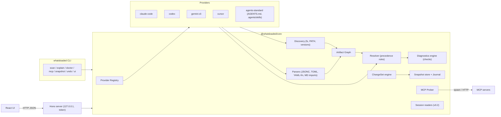
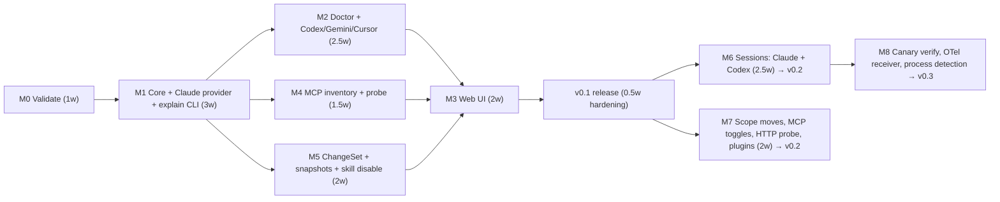

# whatsloaded (formerly "AgentScope"): Product and Technical Blueprint

> Status: planning draft v1 · Date: 2026-11-05 · Audience: the engineer who will build v0.1

---

## 0. Read This First: Three Assumptions I Am Challenging

1. **"Discover, manage, sync" is not new.** Loadout (Tauri desktop app, about 10 agents) already scans global and project configs, manages MCPs, skills, rules, hooks, subagents and plugins, syncs across tools, and estimates context budget. gaal, rulesync, ruler and AIM all handle cross-tool sync. If whatsloaded starts as "another manager", it will be the fifth one, and late.
2. **Some of the features you proposed can't be built as described.**
   - *Start/stop/restart MCP servers.* A stdio MCP server is a child process of the agent. whatsloaded can't attach to it, restart it, or read its status. whatsloaded can only start **its own test instance**. → Rename this to "Probe" and drop lifecycle control.
   - *Live connection status of an agent's MCP servers.* Agents don't expose this. whatsloaded can only report the result of its own probe, plus log files where an agent writes them.
   - *Discover running agent sessions.* Process listing tells you that `claude` is running with some PID, and little more. The useful signal is in **session transcripts on disk** (Claude Code, Codex, Gemini CLI). Cursor keeps sessions in an internal SQLite store, which is fragile to read and should be out of scope.
   - *"Which skills are loaded."* Skills use progressive disclosure: only name and description sit in context until the agent invokes a skill. whatsloaded can say which skills are **eligible** (from config) and which were **invoked** (from transcripts). It can't say which are "loaded" in any stronger sense.
3. **The name "AgentScope" is taken** by Alibaba's `agentscope-ai/agentscope` multi-agent framework. **Resolved: the project is named `whatsloaded`.** The name is the question the tool answers, it is easy to say aloud, and it was free on npm and GitHub when checked on 2026-11-05.

**What whatsloaded should own (the thesis):**

> **An explainer for effective agent context.** Given *(agent, directory)*, show exactly which instructions, skills, MCP servers, hooks and settings apply, where each one came from, what it overrides or is overridden by, what's broken, and how confident we are in each claim.

Compare `git config --show-origin`, `terraform plan`, and `brew doctor`, applied to AI coding agents. None of the projects surveyed does **per-agent precedence resolution with provenance and confidence** as its core product. That is the wedge. Management features follow from it, and only when they are safe.

---

## 1. Executive Summary

- **What:** A local-first, open-source CLI with an optional localhost web UI. It explains, diagnoses and safely changes AI coding agent configuration, and probes MCP servers.
- **Who:** Developers who use 2 or more AI coding agents across several repos, and who maintain skills, rules or MCP setups (power users, DX/platform engineers, authors of skills and MCP servers).
- **Core commands:** `scan` (inventory), `explain` (effective context in a directory), `doctor` (findings with exit codes), `mcp probe`, `snapshot` / `restore`, and later `sessions`.
- **Wedge:** Correct precedence models per agent, provenance for every item, and an honest capability matrix: each fact is labelled *documented*, *verified*, *inferred* or *unobservable*.
- **Explicitly not:** a sync engine, a skills marketplace, an MCP gateway, a token-cost tracker, a security scanner, or an agent runner.
- **Stack:** TypeScript on Node ≥ 22, a single npm package (`npx whatsloaded`), Hono local server, React + Vite UI, official MCP TypeScript SDK. No database in v0.1.
- **MVP:** About 10–12 weeks for one senior engineer. Providers: Claude Code (deep), Codex CLI, Gemini CLI, Cursor (read-only, partial).

---

## 2. Problem Validation

### 2.1 Real, verifiable pains

| Pain | Concrete example | Evidence it's real |
|---|---|---|
| Unknown effective context | Claude Code loads `CLAUDE.md` from **every ancestor directory**, plus `~/.claude/CLAUDE.md`, plus `@imports`, plus `.claude/rules/`. Users rarely know the full set. | Frequent "why is Claude doing X" threads. Many projects ship `CLAUDE.md` alongside `AGENTS.md` wrappers. |
| Silent truncation | Codex concatenates `AGENTS.md` files from the repo root down to cwd and **truncates at `project_doc_max_bytes` (default 32 KiB)**. | The limit is documented. Users don't see that truncation happened. |
| Shadowing | A project-scope subagent or MCP server with the same name silently overrides the user-scope one (Claude Code: local > project > user for MCP). | Documented precedence. No tool surfaces it per directory. |
| Unapproved project MCPs | `.mcp.json` servers need approval in Claude Code. Without it they appear "configured" but never load. | Common confusion. |
| Broken references | `@path` imports that no longer resolve, skill directories whose `SKILL.md` lacks the `name`/`description` frontmatter, MCP `command` not on `PATH`, `${ENV}` references to unset vars. | These fail silently or with vague errors. |
| Fragmentation | The same skill copied into `~/.claude/skills`, `~/.codex/skills`, and `.agents/skills`, with the copies drifting apart. | This is why Loadout, gaal, rulesync and skill-buddy exist. |

### 2.2 Pains that are weaker than they sound

- **"Configuration changes unexpectedly break agent behavior."** This is true, but users usually already have `git` for project configs. The gap is **global** config (`~/.claude`, `~/.codex`, `~/.gemini`), which is rarely version-controlled. → Snapshots matter most for global scope.
- **"Unified view of everything."** Nice, but a view alone isn't a reason to install. Explanations and diagnoses that answer a question the user has *right now* are.

### 2.3 Validation before building (M0, 1 week)

1. Ship a ~300-line throwaway script: `npx whatsloaded-proto explain` for **Claude Code only**. It prints effective memory files, skills, subagents and MCP servers with sources and shadowing.
2. Post it with a screenshot to r/ClaudeAI, r/ChatGPTCoding, and the Claude Code / Codex Discords and GitHub discussions.
3. **Go signal:** ≥ 30 people report "found something I didn't know" (e.g. a forgotten ancestor `CLAUDE.md`, a shadowed server, truncation), or ≥ 5 issues/PRs requesting other agents.
4. **No-go signal:** responses are mostly "Loadout already shows this". In that case, pivot to shipping the resolver as a **library** (`@whatsloaded/core`) and contributing it upstream to Loadout or gaal.

---

## 3. Competitive Landscape

### 3.1 Survey

| Project | Form | What it does well | Overlap with whatsloaded | Gap / why it doesn't own our wedge |
|---|---|---|---|---|
| **MCP Inspector** (official, v2) | Web UI + TUI + CLI (`--cli`), `npx` | Deep protocol debugging of **one** server: tools, resources, prompts, OAuth, JSON output, exit codes | MCP probing | Doesn't know about agent configs. You pass it a command manually. → **Reuse it:** our "Open in Inspector" hands off a server definition. |
| **MCPJam Inspector** | Web app, `npx` | LLM playground, multi-model comparison, JSON-RPC tracing, OAuth debugger, MCP Apps widgets | MCP probing | Server-author focused, not environment focused. Don't compete. |
| **Loadout** (`AmElmo/loadout`) | Tauri 2 desktop app (Rust + React) | Multi-tool discovery (about 10 tools), management of MCPs, skills, rules, hooks, subagents and plugins, cross-tool sync, context-budget estimate, repo scan, Cmd+K | **High**: discovery, inventory, management | Management/sync first. From public material, there is no visible per-agent precedence engine, provenance chain, confidence model, CLI/CI usage, or snapshot/rollback journal. **Our main competitor. Verify its depth hands-on in M0.** |
| **SkillBuddy** (`konnga/skill-buddy` and similar) | Desktop | Skill library: import from git/registries, symlink/copy into tools, some MCP | Skill inventory | Distribution focus. No diagnosis. |
| **gaal** (`getgaal/gaal`) | Go CLI, `gaal.yaml` | Declarative source of truth that syncs skills, MCP and context files to about 20 agents. Non-destructive merge, `--dry-run`, `doctor` (drift, PATH checks), secrets as env refs | `doctor`, dry-run | Requires adopting its YAML as the source of truth, which is a workflow change. Its doctor checks *drift from gaal.yaml*, not effective agent context. |
| **rulesync / ruler / rule-porter** | CLIs | Generate per-tool instruction, MCP and skill files from one source | Instruction duplication | Generators, not inspectors. |
| **AgentSpec** (Oracle `agent-spec` and others) | Spec + SDKs | Portable declarative agent definitions for frameworks | **None.** Different problem (building agents, not configuring coding agents). | Not a competitor. Drop it from the comparison. |
| **Snyk Agent Scan** (ex `mcp-scan`) | Python CLI | Auto-discovers MCP configs and skills, spawns servers, detects tool poisoning and prompt injection. Requires a Snyk token and cloud analysis. | Discovery, MCP spawn | Security only, cloud dependent. → **Don't build a security scanner.** Link to it. |
| **ccusage**, **claude-code-viewer**, CCUsageX | CLI / web | Token and cost analytics, transcript browsing for Claude Code (ccusage also covers Codex) | Session observability | Already good. → **Don't build cost tracking.** Session views should focus on *config-relevant* signals (skills invoked, MCP tool failures). |
| **Docker MCP Toolkit / Gateway** | Desktop + gateway | Containerized MCP catalog, profiles, a gateway proxy that manages lifecycle | MCP management | It is the right answer for MCP lifecycle control. whatsloaded should detect gateway usage, not replicate it. |
| **Native agent commands** | `claude mcp list`, `/memory`, `/context`, `/mcp`, Gemini `/memory show`, `/mcp` | Ground truth inside a live session | Explain, MCP status | One agent at a time, inside a session, no shadowing analysis, no cross-agent view. **Design our output to match theirs, and test against them.** |
| **OTel exporters** (Claude Code, Codex, Gemini CLI) | Built-in | Structured metrics, events and traces | Observability | Requires the user to opt in and run a collector. P2: whatsloaded as a tiny local OTLP receiver. |

### 3.2 Differentiation (what nobody does well)

1. **Per-agent precedence resolution** as versioned, tested code: memory/instruction hierarchy, settings layering, name-conflict rules for skills, subagents, commands and MCP.
2. **Provenance and confidence for every item.** "Loaded because `~/work/CLAUDE.md` is an ancestor of cwd (documented: Claude Code memory docs, verified 2026-10)."
3. **Diagnostics with stable IDs and exit codes**, usable in CI and pre-commit (`whatsloaded doctor --ci`). For example, fail a PR that adds a broken `@import` or a `.mcp.json` server whose command doesn't exist.
4. **Snapshot/rollback journal for global agent config**, which is otherwise unversioned.
5. **Empirical verification ("canary probes")**, P2 and opt-in. Plant unique canary strings in candidate files, run the agent headless (`claude -p`, `codex exec`, `gemini -p`) in a temp directory, and record which canaries it reports. This turns *inferred* precedence into *verified* precedence. No competitor does this.

### 3.3 Positioning statement

> **whatsloaded explains what your AI coding agents actually see in this directory, and why.**
> It doesn't sync, generate or host anything. It reads, diagnoses, and, only when you confirm, makes reversible changes.

Complementary to: MCP Inspector (deep server debugging), gaal/rulesync (sync), Snyk Agent Scan (security), ccusage (cost). Link to each of them from the relevant screen.

---

## 4. Product Requirements

### 4.1 Target users

| Persona | Situation | Primary job |
|---|---|---|
| **Multi-agent power user** (primary) | Uses Claude Code + Codex/Gemini/Cursor across 5–30 repos, has a dozen skills and several MCPs | "Why is the agent behaving like this here?" / "Clean up my mess safely" |
| **Skill / MCP author** | Builds and tests skills or MCP servers locally | "Is my skill discovered, valid, and not shadowed? Does my server start under the agent's exact command and env?" |
| **Repo maintainer / DX engineer** | Owns `CLAUDE.md`, `AGENTS.md`, `.mcp.json` and `.claude/` in a shared repo | "Catch broken agent config in CI. Know what a new contributor's agent will load." |

**Not targeted in v0.x:** enterprise admins (managed policy fleets), non-developers, people who use a single agent with default config.

### 4.2 Primary use cases (ranked)

1. **Explain.** `cd repo && whatsloaded explain --agent claude` → effective context with sources and overrides.
2. **Doctor.** Find broken, duplicate, shadowed, oversized and unapproved items across all agents and projects.
3. **Probe an MCP server** exactly as an agent would launch it (command, args, env, cwd), list its tools, and see stderr when it fails.
4. **Safe change.** Disable a skill, move a skill between scopes, or toggle a project MCP, with a preview diff, snapshot and one-command undo.
5. **Session forensics** (P1). For a project, see recent sessions, which skills and MCP tools were invoked, and which tool calls failed or were slow.

### 4.3 Requirements by capability

Legend: **P0** = v0.1 must have · **P1** = v0.2 · **P2** = later or if validated · **✗** = excluded.

#### A. Environment discovery

| ID | Requirement | Pri |
|---|---|---|
| D1 | Detect installed agents via config dirs, binaries on `PATH`, and app bundles. Report version where cheap (`claude --version`, etc., with a 2 s timeout). | P0 |
| D2 | Discover global scope artifacts per provider (instructions, skills, subagents, commands, MCP, hooks, settings, plugins/extensions). | P0 |
| D3 | Discover project scope for a given directory: walk up to the git root (and beyond where the agent does), and down where the agent does. | P0 |
| D4 | Project registry: projects come from explicit `whatsloaded add <dir>`, the cwd, and **agent-known projects** (keys of `~/.claude.json` `projects`, Codex trusted projects, transcript dirs). **No full-disk crawl.** | P0 |
| D5 | Managed/enterprise policy files: detect and display as read-only top-precedence layers. | P1 |
| D6 | Plugin/extension expansion: Claude Code plugins, Gemini extensions contributing skills, commands and MCP. | P1 |
| D7 | Watch mode (fs events) for live UI refresh. | P1 |

#### B. Configuration intelligence

| ID | Requirement | Pri |
|---|---|---|
| I1 | `explain(agent, dir)` → ordered layers and effective items, with provenance (file, line range where possible, rule that included it). | P0 |
| I2 | Shadowing: same logical name in multiple scopes → winner and losers, with the rule cited. | P0 |
| I3 | Duplicates across agents: same skill (by name **and** content hash) in multiple tool dirs. Classified as identical, diverged, or name-collision-only. | P0 |
| I4 | Instruction size: bytes and an approximate token count per file and total. Flag provider limits (Codex `project_doc_max_bytes`). | P0 |
| I5 | Validation: parse errors (JSON/JSONC/TOML/YAML frontmatter), schema problems (missing `name`/`description`, invalid MCP entry), broken `@imports`, symlink loops, missing commands, unset env refs. | P0 |
| I6 | Confidence label on every precedence claim: `documented` · `verified` · `inferred` · `unobservable`. | P0 |
| I7 | Cross-agent matrix: for one directory, which agents see which instruction files and skills (e.g. `AGENTS.md` is read by Codex and Cursor, but by Claude Code only via `@AGENTS.md` import). | P1 |
| I8 | Canary verification (`whatsloaded verify`). Opt-in, costs tokens, needs agent auth. | P2 |
| ✗ | Semantic conflict detection between instructions ("file A says tabs, file B says spaces"). Needs an LLM, is unreliable, and conflicts with local-first and no-account. Revisit only as an optional BYO-model plugin. | ✗ |

#### C. Configuration management

| ID | Requirement | Pri |
|---|---|---|
| M1 | ChangeSet pipeline: plan → preview diff → explicit confirm → snapshot → atomic apply → re-parse verify → journal. **Every write goes through it.** | P0 |
| M2 | Manual snapshot / list / restore of all agent config files (global + selected project). | P0 |
| M3 | Disable/enable a skill (Claude Code, Codex, Gemini) by moving it to a quarantine area with a manifest. Exact restore. | P0 |
| M4 | Undo the last ChangeSet / roll back to any journal entry, with a drift check. | P0 |
| M5 | Move or copy a skill or subagent between global and project scope. | P1 |
| M6 | Enable/disable a project MCP server via native mechanisms (Claude Code `enabledMcpjsonServers` / `disabledMcpjsonServers`; Gemini `excludeMCPServers` / `mcp.excluded`, *verify key*). | P1 |
| M7 | Diff any two snapshots, or a snapshot against the current state. | P1 |
| M8 | Edit MCP entries (env, args) through the UI. | P2 |
| ✗ | Cross-agent sync and translation of config formats. Owned by gaal, rulesync, ruler and Loadout. | ✗ |
| ✗ | Installing skills or MCPs from registries or marketplaces. | ✗ |
| ✗ | Writes to Codex `config.toml` until a format-preserving TOML editor is proven (see §8.7). | ✗ (v0.1) |

#### D. MCP

| ID | Requirement | Pri |
|---|---|---|
| P1r | Inventory every configured MCP server across agents and scopes: transport, command/url, env keys (values redacted), which agents and dirs it applies to, shadowing. | P0 |
| P2r | Static checks: command resolvable on `PATH` *as the agent would see it* (see risks: GUI apps have a different `PATH`), referenced env vars set, URL syntax, duplicate names. | P0 |
| P3r | Probe stdio servers: spawn with the exact command/args/env/cwd, `initialize`, `tools/list`, `resources/list`, `prompts/list`, capture stderr, timings, exit code, timeout 15 s. **Requires per-server user confirmation, shown with the full command.** | P0 |
| P4r | Probe Streamable HTTP / SSE servers: unauthenticated `initialize`. Report `401` / OAuth-required as a status, not an error. | P1 |
| P5r | "Open in MCP Inspector": launch `npx @modelcontextprotocol/inspector <cmd>` with the same definition. | P1 |
| P6r | Show agent-written MCP logs where they exist (Claude Desktop `~/Library/Logs/Claude/mcp*.log`; Claude Code debug logs when present; Gemini telemetry file). | P1 |
| P7r | Invoke a tool with arguments from the UI. | P2 (Inspector already does this. Prefer the handoff.) |
| ✗ | Start/stop/restart the agent's MCP processes, gateway/proxy mode, OAuth flows. | ✗ |

#### E. Agent observability

What can actually be observed:

| Agent | Passive source (no setup) | Opt-in source | Unobservable |
|---|---|---|---|
| Claude Code | JSONL transcripts in `~/.claude/projects/<encoded-path>/*.jsonl` (messages, tool_use / tool_result, timestamps, token usage, Skill tool invocations, subagent sidechains) | Hooks (`PreToolUse`, `PostToolUse`, `SessionStart`, `Stop`…) writing to an whatsloaded spool; native OTel | The exact assembled system prompt, live MCP connection state |
| Codex CLI | Rollout JSONL in `~/.codex/sessions/YYYY/MM/DD/rollout-*.jsonl` | `[otel]` in `config.toml` | Same as above |
| Gemini CLI | Checkpoints/logs under `~/.gemini/tmp/<project-hash>/` (*format less stable, verify*) | Telemetry to a local file (`telemetry.outfile`) or OTLP | Same |
| Cursor | Internal SQLite (`state.vscdb`), undocumented | None stable | **Treat as unsupported** |

| ID | Requirement | Pri |
|---|---|---|
| O1 | Session list per project (Claude Code, Codex): start/end time, turns, model, tool-call count, errors. | P1 |
| O2 | Session detail: timeline of tool calls with duration (tool_use → tool_result timestamps), error flag, MCP server/tool attribution, skills invoked, subagents spawned. | P1 |
| O3 | Aggregates per project: top failing MCP tools, p50/p95 tool latency, skills never invoked in 30 days ("dead skills"). | P1. "Dead skills" is the most config-relevant insight. |
| O4 | Running sessions: detect agent processes and map cwd → project (`ps` + `lsof -p` on macOS / `/proc/<pid>/cwd` on Linux). Show as "active". | P2 |
| O5 | Local OTLP/HTTP receiver (`whatsloaded otel`) on `127.0.0.1:4318`, stored in SQLite. | P2 |
| O6 | Optional hook installer (Claude Code) to capture `SessionStart` payloads: the reliable "what was active at session start" signal. A ChangeSet like any other write. | P2 |
| ✗ | Token / cost analytics (ccusage owns this), transcript full-text search UI, replay or resume sessions. | ✗ |

### 4.4 Global non-functional requirements

- Read-only by default. `scan`, `explain`, `doctor` and `sessions` never write outside `~/.whatsloaded/`.
- No network access, except (a) MCP HTTP probes the user explicitly triggers and (b) an opt-in update check. **No telemetry.**
- Cold `explain` for a typical setup in **< 500 ms**. Full `scan` of 30 projects in **< 3 s**.
- Works when a provider is missing or unsupported: per-provider failures are isolated and shown as findings.
- macOS and Linux first-class. Windows best-effort in v0.1 (path rules are in place, but CI only covers macOS and Linux).

---

## 5. MVP Scope (v0.1)

### 5.1 In scope

| Area | P0 deliverable |
|---|---|
| Providers | **Claude Code** (memory, rules, skills, subagents, commands, MCP across user/project/local scopes, hooks, settings layers, `.mcp.json` approval state). **Codex** (`AGENTS.md`/override chain and size limit, `config.toml` MCP, skills). **Gemini CLI** (`GEMINI.md` hierarchy incl. custom `context.fileName`, settings layers, MCP, extensions listed but not expanded). **Cursor** (`.cursor/rules/*.mdc` with frontmatter, legacy `.cursorrules`, `AGENTS.md`, `~/.cursor/mcp.json` + `.cursor/mcp.json`; User Rules marked *unobservable*). |
| CLI | `scan`, `explain`, `doctor`, `mcp list`, `mcp probe`, `snapshot`, `restore`, `undo`, `skill disable/enable`, `ui`. Each command takes `--json`. |
| UI | `whatsloaded ui` → localhost. Screens: Overview, Project Explain, Inventory, Issues, MCP, History. |
| Writes | ChangeSet engine + snapshot + skill disable/enable (+ undo). Nothing else writes. |

### 5.2 Explicitly out of v0.1

Session observability (v0.2), scope moves, MCP toggles, HTTP MCP probing, plugin expansion, watch mode, Windows CI, canary verification, OTel receiver, any sync or registry feature, a desktop app wrapper, and any LLM usage.

### 5.3 Acceptance criteria

**Discovery and explain**
- AC1: With a fixture `$HOME` containing ancestor `CLAUDE.md` files at 3 levels, `~/.claude/CLAUDE.md`, a 2-hop `@import` chain, and `.claude/rules/*.md`, `explain --agent claude` lists every file in documented load order. Each entry has `source.path`, `scope`, `reason`, `confidence`. Golden-file test.
- AC2: A subagent `reviewer` defined in both `~/.claude/agents/` and `<proj>/.claude/agents/` → project wins, and the user copy appears as `shadowed` with rule `claude.subagents.project-over-user`.
- AC3: An MCP server `github` in user, project (`.mcp.json`) and local scope → local wins, and the other two appear as shadowed. An unapproved `.mcp.json` server is shown as `pending-approval`, not `active`.
- AC4: Codex fixture with `AGENTS.md` files at repo root and in a subdirectory whose combined size exceeds `project_doc_max_bytes` → `explain --agent codex` shows the concatenation order and finding `CODEX_DOC_TRUNCATED` with the byte position where content is cut.
- AC5: Gemini fixture with `context.fileName: ["AGENTS.md","GEMINI.md"]` → both file names are honored in the hierarchy.
- AC6: Removing a provider's directory entirely → `scan` succeeds, and that provider shows `not-installed` with no stack traces.

**Doctor**
- AC7: Each finding has a stable `id`, a `severity` (error/warn/info), `provider`, `location`, a human message, and a `fix` hint. `doctor` exits 0 with no errors, 1 with errors, and 2 on internal failure. `--ci` limits checks to project scope.
- AC8: Detects at least: invalid JSON/JSONC/TOML, missing SKILL.md frontmatter fields, skill dir name ≠ `name`, broken `@import`, MCP command not found, unset `${VAR}` env refs, duplicate skill names across scopes (identical vs diverged by sha256), oversized instruction files, and symlinks pointing outside or looping.

**MCP probe**
- AC9: `mcp probe <name>` shows the exact command, args, cwd, and env keys (values masked), and asks for confirmation (`--yes` skips it, for scripting). It reports `initialize` latency, server name/version, protocol version, and counts plus names of tools/resources/prompts.
- AC10: For a server that exits immediately, the output includes the exit code and the last 50 lines of stderr. For a server that hangs, the probe times out at 15 s and kills the whole process group, leaving no orphans (verified in a test).
- AC11: Probing never runs automatically during `scan` or when the UI loads.

**Writes**
- AC12: `skill disable foo --agent claude --scope user` prints a plan (move `~/.claude/skills/foo/` → `~/.whatsloaded/quarantine/<id>/…`), asks for confirmation, and creates a snapshot before applying. After it runs, `explain` no longer lists `foo` and `history` shows the entry.
- AC13: `undo` restores byte-identical files, compared by sha256. If a target file changed after the ChangeSet, `undo` refuses and shows a 3-way summary unless `--force` is given.
- AC14: Killing the process mid-apply leaves either the pre-state or the post-state, never a partial file (temp file + rename; the journal is written before and after).
- AC15: No command other than the M1 pipeline writes outside `~/.whatsloaded/`. A test wraps `fs` and fails on any unexpected write during `scan`, `explain` and `doctor`.

**UI and security**
- AC16: The server binds only to `127.0.0.1` and requires a per-launch random token (in the URL opened by the CLI and kept in a cookie afterwards). Requests with a foreign `Host` or `Origin` are rejected (DNS-rebinding defense).
- AC17: Secret-looking values (MCP `env`, `headers`, tokens in args matching known patterns) are masked in UI, CLI and `--json` output unless `--show-secrets` is given.

---

## 6. UX Architecture

### 6.1 Principles

- **CLI first, UI second.** Every UI screen is a view over a CLI `--json` command. This keeps the core testable and makes the tool useful over SSH.
- One question per screen. Avoid dashboards of gauges.
- Every status has a "why". Clicking any badge (`shadowed`, `pending-approval`, `inferred`) opens the rule, the source file, and a docs link.
- Read view by default. Write actions sit behind a clearly separate "Change…" button that opens a plan/diff dialog.

### 6.2 Navigation

```
┌───────────────┬─────────────────────────────────────────────┐
│ whatsloaded    │  [Project ▾ ~/work/api]   [Agent ▾ Claude]  │
│               │                                             │
│ ◉ Overview    │                                             │
│ ○ Explain     │                                             │
│ ○ Inventory   │                                             │
│ ○ Issues  (7) │                                             │
│ ○ MCP         │                                             │
│ ○ Sessions*   │   * v0.2                                    │
│ ○ History     │                                             │
└───────────────┴─────────────────────────────────────────────┘
```

Two global selectors: **Project** (or "Global only") and **Agent**. Most screens are a function of `(project, agent)`.

### 6.3 Screens

| Screen | Purpose | Content |
|---|---|---|
| **Overview** | "What's on this machine?" | Detected agents + versions + capability matrix (✓ supported / ◐ partial / ✗ unobservable). Known projects. Issue counts by severity. No charts. |
| **Explain** (the hero screen) | "What does *Agent* see in *Project*?" | Vertical **layer stack** from highest to lowest precedence (managed → local → project → ancestors → user). Each layer lists items. Grouped tabs: Instructions · Skills · Subagents · Commands · MCP · Hooks · Settings. Shadowed items are struck through with a "→ overridden by" link. Right pane: file preview with an include reason and confidence badge. Header: total instruction bytes / ≈tokens. "Compare agents" toggle → side-by-side columns per agent (P1). |
| **Inventory** | "Everything, everywhere" | A filterable table of all artifacts across agents and scopes. Columns: kind, name, agent(s), scope, path, hash-group, status. Group-by-name reveals duplicates (identical / diverged). |
| **Issues** | "What's broken?" | Findings list sorted by severity, filterable by provider and project. Each shows the message, location (click → file preview at the line), fix hint, and a "Copy CLI command" button. |
| **MCP** | "Do my servers work?" | Servers merged by `(name, definition hash)`, with the agents and scopes where each applies. Static check results. "Probe" button → confirmation modal with the exact command → result panel (capabilities, tools, timing, stderr). "Open in Inspector". |
| **History** | "What did whatsloaded change?" | Journal of ChangeSets and snapshots. Each entry: diff viewer, Undo/Restore with drift warning. |
| **Sessions** (v0.2) | "What happened in recent runs?" | Per project: session list → timeline of tool calls (bar = duration, red = error), skills invoked, MCP attribution. A "Dead skills" panel. |

### 6.4 Key workflows

**W1: "Why is Claude ignoring my rule?"**
1. `whatsloaded explain` in the repo (or UI → Explain).
2. The user sees that their rule lives in `~/.claude/CLAUDE.md`, and that a `CLAUDE.md` in an ancestor directory, `~/work/CLAUDE.md`, contradicts it. Both are loaded. The order and reason are shown.
3. Not automated: whatsloaded doesn't judge semantic conflicts. It shows both files next to each other with load order. The user edits in their own editor ("Open in $EDITOR").

**W2: "My MCP server isn't working in Cursor but works in Claude."**
1. MCP screen → filter `postgres`. Two definitions with **different hashes**: Cursor's lacks `DATABASE_URL` in `env`.
2. Static check: `DATABASE_URL referenced but not set in Cursor's environment (GUI apps don't inherit shell env)`.
3. Probe each definition and compare the results.

**W3: "Clean up duplicate skills."**
1. Inventory → group by name → `pdf-tools` exists in `~/.claude/skills`, `~/.codex/skills`, `.agents/skills`. Two copies are identical, one has diverged.
2. Diff the diverged copy. Disable the stale one → plan dialog → confirm → snapshot → applied. Undo is available in History.

**W4: "Gate agent config in CI."**
`npx whatsloaded doctor --ci --json > report.json` in a GitHub Action. A PR adding `.mcp.json` with a typo'd command fails with `MCP_COMMAND_NOT_FOUND`.

---

## 7. Technical Architecture

### 7.1 Decisions

| Decision | Choice | Rationale | Rejected |
|---|---|---|---|
| Language | **TypeScript (Node ≥ 22)** | Official MCP TS SDK. Same ecosystem as MCP Inspector, Claude Code and Gemini CLI. `npx` zero-install for the target audience. Mature JSONC (`jsonc-parser`, comment-preserving edits) and YAML (`yaml`, Document API) libraries. One language across CLI, server and UI. | Rust/Tauri (Loadout already occupies that, and it slows iteration), Go (gaal; weaker MCP SDK and UI story), Python (packaging friction) |
| Form factor | **CLI + embedded localhost web UI** (`whatsloaded ui`) | Works headless and in CI. Same model as MCP Inspector. No code signing or notarization in v0.1. | Electron/Tauri desktop app (revisit in v1 only if users ask for a tray app) |
| Server | **Hono** on `@hono/node-server` | Tiny, typed, easy to lock down | Express (heavier, looser), Fastify (fine but more than needed) |
| UI | **React + Vite + TanStack Query + TanStack Router**, Tailwind + a few Radix primitives, CodeMirror 6 for file preview/diff | Fast to build. Diff/merge views are available through `@codemirror/merge` | Next.js (SSR unnecessary), a component-heavy dashboard kit |
| CLI | `commander` (or `citty`), `picocolors`, `@clack/prompts` for confirmations | Small and conventional | oclif (overkill) |
| Parsing | `jsonc-parser`, `smol-toml` (read), `yaml` + `gray-matter`-style frontmatter split, `fast-glob`, `picomatch` | Lenient reads, precise locations | |
| MCP | `@modelcontextprotocol/sdk` client (`StdioClientTransport`, `StreamableHTTPClientTransport`) | Official, spec-tracking | Hand-rolled JSON-RPC |
| Storage | **Plain files under `~/.whatsloaded/`** (JSON manifests + content-addressed blobs). SQLite (`node:sqlite`, or `better-sqlite3` as fallback) **only from v0.2** for the session index and OTel. | No DB needed to resolve config. Files are small and resolving is cheap | Mandatory DB from day 1 |
| Packaging | **Single npm package** with the bundled UI (`dist/web`), built with `tsup`. pnpm workspace internally: `core`, `providers`, `cli`, `server`, `web`. Publish `@whatsloaded/core` separately once the API is stable (v0.3). | One install, while keeping internal boundaries | Multiple user-facing packages early |

### 7.2 Component diagram



**Process model:** one Node process. `whatsloaded ui` = the same process serving the API and static UI. MCP probes are child processes in their own process group. No daemon in v0.1.

### 7.3 Provider / adapter architecture

A provider is a **TypeScript module plus a declarative rules table**. Path layout and precedence are data, kept separate from code, so they're easy to review against docs and to version.

```ts
export interface Provider {
  id: ProviderId;                      // 'claude-code' | 'codex' | 'gemini-cli' | 'cursor' | ...
  displayName: string;
  capabilities: CapabilityMatrix;      // what we can see/do, with confidence
  detect(ctx: Env): Promise<Detection>;           // installed? version? config roots?
  discover(ctx: Env, scope: ScopeQuery): Promise<Artifact[]>;   // pure reads
  resolve(ctx: Env, dir: AbsPath, artifacts: Artifact[]): ResolvedContext; // pure function
  checks: Check[];                     // provider-specific diagnostics
  mutations?: MutationHandlers;        // only for supported write ops
  sessions?: SessionReader;            // v0.2
  rulesVersion: string;                // e.g. 'claude-code@2026-10'
  appliesToVersions?: string;          // semver range of the agent this ruleset was verified on
}
```

Design rules:
- **`discover` is I/O. `resolve` is pure.** All precedence logic is unit-testable with in-memory fixtures.
- Shared building blocks, not inheritance: `walkAncestors(dir, stopAt)`, `walkDescendants(dir, {maxDirs, ignore})`, `readSkillDir()`, `readMcpJson(shape)`, `expandImports(md, {syntax:'@path', maxDepth})`.
- **Cross-agent standards provider** (`agents-standard`): `AGENTS.md` and `.agents/skills/` artifacts are discovered once and *referenced* by every provider that consumes them. This avoids duplicates in Inventory.
- **Versioned rules.** If the detected agent version is outside `appliesToVersions`, lower confidence from `documented` to `inferred` and show a banner. Agents change monthly, and this guards against confidently wrong output.
- Adding a provider means one directory: `providers/<id>/{index.ts, paths.ts, precedence.ts, checks.ts, fixtures/, README.md (with doc links + last verified date)}`. A contributor guide plus a fixture harness are part of v0.1.

### 7.4 Provider knowledge base (starting point; **every row must be re-verified against current docs in M1**)

| Agent | Instructions | Skills / subagents / commands | MCP | Settings / hooks |
|---|---|---|---|---|
| **Claude Code** | *Verified 2026-11-05; see [IMPLEMENTATION-M0-M1.md §2](IMPLEMENTATION-M0-M1.md) for the authoritative table.* Managed `CLAUDE.md` → `~/.claude/CLAUDE.md` → `CLAUDE.md` / `.claude/CLAUDE.md` in cwd and ancestors, plus `CLAUDE.local.md` (supported) → nested subdir `CLAUDE.md` loaded lazily (conditional). `@path` imports, **max 4 hops**. `.claude/rules/**/*.md` with `paths:` (conditional). Auto memory `MEMORY.md`. | Skills: **managed > personal `~/.claude/skills` > project `.claude/skills`** (personal wins). Plugin skills namespaced. Legacy commands lose to a same-name skill. Subagents: **managed > `--agents` > project > user > plugin** (project wins, the opposite of skills). | **managed > local** (`~/.claude.json` `projects[<path>].mcpServers`) **> project** (`.mcp.json`, needs approval) **> user** (`~/.claude.json` `mcpServers`) **> plugins/connectors**. Whole-definition override, no field merge. | managed (`managed-settings.json` + `.d/`) > CLI flags > `.claude/settings.local.json` > `.claude/settings.json` > `~/.claude/settings.json`. Arrays accumulate. Hooks are additive across all layers. `allowManagedHooksOnly`. |
| **Codex CLI** | `~/.codex/AGENTS.override.md` or `AGENTS.md` (global) → from git root down to cwd, in each dir `AGENTS.override.md` > `AGENTS.md` > `project_doc_fallback_filenames`. Concatenated root→leaf, truncated at `project_doc_max_bytes` (32 KiB default). `CODEX_HOME` overrides `~/.codex`. | Skills: `~/.codex/skills/`, repo-level `.codex/skills/` and/or `.agents/skills/` (*verify current convention*). | `[mcp_servers.<name>]` in `~/.codex/config.toml` (+ project `.codex/config.toml` for trusted projects, *verify*). Fields: `command`, `args`, `env`, `url`, `enabled`, timeouts. | `config.toml` + `profiles.<name>` + `-c` overrides. Trusted projects list. |
| **Gemini CLI** | `context.fileName` (default `GEMINI.md`, may be a list incl. `AGENTS.md`). Global `~/.gemini/GEMINI.md` → ancestors up to project root (`.git`) → **descendants** below cwd (bounded scan, respects ignore files). `@file` imports. Extension context files. | Custom commands: `~/.gemini/commands/*.toml`, `.gemini/commands/*.toml`. Extensions: `~/.gemini/extensions/*/gemini-extension.json` (contribute MCP, context, commands). Skills support: *verify*. | `mcpServers` in settings.json (each layer). Allow/exclude lists. | system defaults < user `~/.gemini/settings.json` < project `.gemini/settings.json` < system overrides < env < CLI args. |
| **Cursor** | `.cursor/rules/**/*.mdc` (frontmatter `description`, `globs`, `alwaysApply` → classify as always / auto-attached / agent-requested / manual), legacy `.cursorrules`, `AGENTS.md` (root + nested). **User Rules live in app storage → `unobservable`.** | Skills/commands: *verify current state*. | `~/.cursor/mcp.json` (global), `.cursor/mcp.json` (project). Per-server enable toggles live in app state → `unobservable`. | Mostly app-internal → mark unobservable. |

> [!IMPORTANT]
> This table is a hypothesis. M1 starts by writing a `providers/<id>/README.md` that cites a doc URL for every rule, plus fixture tests. Rules with no doc citation ship with `confidence: inferred`.

### 7.5 Filesystem discovery

- **Roots:** `$HOME` (respect `CLAUDE_CONFIG_DIR`, `CODEX_HOME`, `GEMINI_CLI_HOME`-style overrides where documented), OS managed-policy dirs, and project dirs from the registry.
- **Project registry** (`~/.whatsloaded/projects.json`): explicit adds, plus suggestions from agent-known projects (Claude `~/.claude.json` `projects` keys, Claude transcript dir names decoded, Codex trusted projects). Suggestions require a one-click "track" in the UI. **No crawling `~/` for `.git`.**
- **Walks:** ancestors stop at `/` (Claude) or the git root (Codex/Gemini) per provider rule. Descendants (Gemini, nested CLAUDE.md, Cursor nested rules) are bounded: `maxDirs=200`, skip `node_modules`, `.git`, `dist`, `build`, `.venv`, and honor `.gitignore` via `ignore`.
- **Symlinks:** resolve with `realpath`. Record both link and target. Detect loops (visited set of `dev:ino`). Flag targets outside `$HOME`/project as `info`.
- **Robustness:** every read is wrapped. Failure → a `Finding` (`READ_ERROR`, `PARSE_ERROR`) attached to the artifact, never a crash. Files > 1 MiB are hashed but not fully parsed (flagged).
- **Caching:** an in-process cache keyed by `(path, mtimeMs, size)`. No persistent cache needed in v0.1.

### 7.6 Precedence and conflict model

Normalize every provider into one model:

1. **Layers.** An ordered list of `Layer { id, scope, precedence, source }`. Scopes: `managed`, `cli`, `local`, `project`, `ancestor(n)`, `user`, `plugin(id)`, `extension(id)`, `builtin`.
2. **Artifacts** carry a `kind` and a `logicalKey` (e.g. `skill:pdf-tools`, `mcp:github`, `subagent:reviewer`, `setting:permissions.allow`).
3. **Combination strategy per kind** (declared in the provider's precedence table):
   - `override`: highest layer wins, the rest are `shadowed` (subagents, MCP by name, scalar settings).
   - `concat`: all apply, in order (memory/instruction files, Codex AGENTS chain).
   - `merge`: deep-merge objects, arrays per rule (settings objects, hooks, permission lists).
   - `namespaced`: no conflict by design (plugin skills `plugin:name`), but still flag near-collisions.
   - `conditional`: applies only when a condition holds (Cursor globs, Claude `paths:` rules, lazily loaded subdir CLAUDE.md). Show as "conditional" with the condition text. **Never claim it's active.**
4. **Result.** `ResolvedContext { effective: ResolvedItem[], shadowed: ShadowEdge[], conditional: ResolvedItem[], unobservable: Note[] }`. Each `ResolvedItem` cites the rule ID that placed it.
5. **Conflict classes produced by diagnostics:**
   - `SHADOWED`: same key, override strategy (info, or warn if definitions differ).
   - `DUPLICATE_IDENTICAL`: same content hash in multiple places (info, "consider consolidating").
   - `DUPLICATE_DIVERGED`: same name, different hash, across agents or scopes (warn).
   - `UNREACHABLE`: an artifact that can never apply (e.g. disabled via settings, unapproved `.mcp.json`, skill missing required frontmatter).
   - `LIMIT_EXCEEDED`: size limits, descendant scan limits.

### 7.7 Backup, diff, rollback

```
~/.whatsloaded/
  config.json
  projects.json
  blobs/sha256/ab/cdef…             # content-addressed, zstd/gzip optional later
  snapshots/2026-11-05T08-30-12Z-<id>.json
  journal/000123-<changeset-id>.json
  quarantine/<changeset-id>/<original-relative-path>/…
  locks/
```

- **Snapshot** = manifest `{id, createdAt, reason, entries: [{path, sha256, mode, mtime, exists}]}` + blobs. Scope: the explicit file set touched by a ChangeSet (automatic), or "all known agent config files" (manual `snapshot`). Transcripts and caches are excluded. Retention: keep the last 50 automatic snapshots, all manual ones, configurable.
- **ChangeSet** = `{id, title, ops: Op[], preconditions: [{path, sha256|absent}], snapshotId, status}`. Ops are a small closed set: `writeFile(path, content)`, `jsonEdit(path, jsonPath, value|delete)` (via `jsonc-parser.modify` to preserve comments and formatting), `move(src, dst)`, `mkdir`, `remove(path)` (implemented as a move to quarantine, **never `unlink`**).
- **Apply algorithm:**
  1. Take a lock (`~/.whatsloaded/locks/apply.lock`, O_EXCL).
  2. Re-check preconditions (optimistic concurrency: the file hash must equal the hash at plan time). If it doesn't match, abort and re-plan.
  3. Write snapshot blobs and a journal entry with `status: applying`.
  4. Execute ops. Each file write goes to a temp file in the same dir, then `fsync`, then `rename`. Keep the original mode.
  5. Re-parse every touched file with the provider parser. On failure, auto-restore from the snapshot and mark `status: rolled-back`.
  6. Mark `status: applied` and record post-hashes.
  7. On startup, any journal entry left in `applying` → prompt the user to restore.
- **Undo / restore:** for each entry, compare the current hash with the recorded post-hash. If they match, restore the pre-blob. If they differ, the file was changed externally: show a 3-way view (pre / post / current) and require `--force` or skip per file.
- **Diff:** unified text diff (`diff` npm package) in the CLI. CodeMirror merge view in the UI. For JSON, also show a semantic diff of keys added/removed/changed.
- **Concurrency hazard:** `~/.claude.json` is rewritten frequently by a running Claude Code. Before writing it: detect running `claude` processes and warn "close Claude Code sessions first". Plan and apply within one short window. Re-verify the hash immediately before rename. **In v0.1 we do not write `~/.claude.json` at all.** M6 (MCP toggles, v0.2) introduces it.
- **Skill disable via quarantine:** move the dir into `quarantine/<cs-id>/...` and record the original path. Rationale: most agents have no native "disabled" flag for skills, and renaming in place (e.g. to `_foo`) still risks being picked up or confusing other tools. Where a native mechanism exists (Claude Code plugins `enabledPlugins`, MCP approval lists, Codex `enabled = false`), prefer it in later versions.

### 7.8 MCP integration

- **Inventory normalization:** every provider maps its MCP shape to an `McpServerDef { name, transport: 'stdio'|'http'|'sse', command?, args?, env?, cwd?, url?, headers?, enabled?, origin }`. The definition hash (`defHash`) is computed over a canonical JSON with **env values included** (so differences are detected) but output with values redacted.
- **Static checks:** `which` against a computed PATH. **Important:** GUI apps (Cursor, Claude Desktop) on macOS don't inherit your shell `PATH`. Run checks with both the shell PATH and a "GUI PATH" (`/usr/bin:/bin:/usr/sbin:/sbin` + `launchctl getenv PATH` where available), and flag "works in terminal agents, likely fails in GUI agents". This is a common real-world failure and a strong diagnostic. Also expand `${VAR}` / `$VAR` per each agent's documented interpolation rules.
- **Probe lifecycle (stdio):** confirm → `spawn(command, args, {env: mergedEnv, cwd, detached: true})` → SDK `Client.connect(StdioClientTransport)` → `initialize` (timeout 10 s) → `listTools/listResources/listPrompts` (timeout 5 s each, tolerate `MethodNotFound`) → `close` → SIGTERM to the process group → SIGKILL after 2 s. Capture stderr into a ring buffer (64 KiB). Record timings. Never call tools during a probe.
- **Probe (HTTP), P1:** Streamable HTTP first, fall back to SSE. `401` + `WWW-Authenticate` → status `auth-required`, with a hint pointing to MCP Inspector's OAuth debugger.
- **Result caching:** `~/.whatsloaded/mcp-probes/<defHash>.json` (last result only), shown as "last probed 3 h ago". Never auto-refresh.
- **Inspector handoff:** build the command line for `npx @modelcontextprotocol/inspector` with the same command/args/env and show or copy it. Optionally launch it after confirmation.

### 7.9 Session readers (v0.2)

- `SessionReader { listSessions(projectDir): SessionSummary[]; readSession(id): SessionEvent[] }`, streaming line-by-line (transcripts can reach hundreds of MB).
- **Parsers must be tolerant.** These formats are undocumented and change. Unknown event types are kept as `raw` and counted, so a format drift shows up as a visible "x% unparsed" indicator instead of silent data loss.
- Index into SQLite (`sessions`, `tool_calls`, `skill_invocations`) keyed by `(file, byteOffset)` for incremental updates.
- Attribution: Claude MCP tool names follow `mcp__<server>__<tool>`, so map them to `McpServerDef`. Skill invocations come from the `Skill` tool_use input. Codex has equivalent function-call items.

---

## 8. Data Models and Interfaces

### 8.1 Core types

```ts
type ProviderId = 'claude-code' | 'codex' | 'gemini-cli' | 'cursor' | 'agents-standard' | string;
type Confidence = 'documented' | 'verified' | 'inferred' | 'unobservable';
type ScopeKind = 'managed' | 'cli' | 'local' | 'project' | 'ancestor' | 'descendant'
               | 'user' | 'plugin' | 'extension' | 'builtin';
type ArtifactKind = 'instruction' | 'rule' | 'skill' | 'subagent' | 'command'
                  | 'mcp-server' | 'hook' | 'setting' | 'plugin' | 'extension';

interface SourceRef {
  path: string;             // absolute, realpath-resolved
  linkPath?: string;        // if reached via symlink
  range?: { startLine: number; endLine: number };
  sha256: string;
  sizeBytes: number;
  mtimeMs: number;
}

interface Artifact {
  id: string;               // stable: hash(provider, kind, source.path, logicalKey)
  provider: ProviderId;
  consumers: ProviderId[];  // e.g. AGENTS.md consumed by codex, cursor
  kind: ArtifactKind;
  logicalKey: string;       // 'skill:pdf-tools', 'mcp:github', 'setting:permissions.allow'
  name: string;
  scope: { kind: ScopeKind; depth?: number; projectRoot?: string; owner?: string };
  source: SourceRef;
  data: SkillData | McpServerDef | InstructionData | SettingData | HookData | unknown;
  findings: Finding[];      // parse/validation findings local to this artifact
}

interface InstructionData { bytes: number; approxTokens: number; imports: ImportEdge[];
  condition?: { type: 'glob' | 'lazy-subdir' | 'agent-requested' | 'manual'; value?: string } }
interface ImportEdge { raw: string; resolvedPath?: string; ok: boolean; depth: number }
interface SkillData { declaredName?: string; description?: string; dirName: string;
  files: number; contentHash: string /* hash of whole dir tree */ }

interface McpServerDef {
  name: string; transport: 'stdio' | 'http' | 'sse';
  command?: string; args?: string[]; cwd?: string; url?: string;
  env?: Record<string, Secretish>; headers?: Record<string, Secretish>;
  enabled?: boolean; approval?: 'approved' | 'pending' | 'denied' | 'n/a';
  defHash: string;
}
type Secretish = { redacted: true; length: number; ref?: string /* '${VAR}' */ } | string;
```

### 8.2 Resolution output

```ts
interface ResolvedContext {
  provider: ProviderId;
  dir: string;
  agentVersion?: string;
  rulesVersion: string;
  layers: Layer[];                         // ordered high → low
  effective: ResolvedItem[];
  conditional: ResolvedItem[];
  shadowed: ShadowEdge[];
  unobservable: { what: string; why: string }[];
  totals: { instructionBytes: number; approxTokens: number };
}
interface Layer { id: string; scope: Artifact['scope']; label: string; precedence: number }
interface ResolvedItem { artifactId: string; layerId: string; order: number;
  ruleId: string; reason: string; confidence: Confidence }
interface ShadowEdge { winner: string; loser: string; logicalKey: string;
  ruleId: string; definitionsDiffer: boolean }
```

### 8.3 Diagnostics

```ts
interface Finding {
  id: string;               // stable code, e.g. 'MCP_COMMAND_NOT_FOUND'
  severity: 'error' | 'warn' | 'info';
  provider?: ProviderId;
  artifactIds: string[];
  location?: SourceRef;
  message: string;          // human, specific: includes names/paths
  explanation?: string;     // why it matters for agent behavior
  fix?: { text: string; command?: string /* whatsloaded CLI */ };
  docs?: string;            // URL
}
interface Check { id: string; appliesTo: ArtifactKind[] | 'context';
  run(input: { artifacts: Artifact[]; resolved?: ResolvedContext; env: Env }): Finding[] }
```

The v0.1 check catalog ships with ~20 checks. Each check has a fixture that triggers it and one that doesn't.

### 8.4 Changes and snapshots

```ts
type Op =
  | { type: 'writeFile'; path: string; content: string }
  | { type: 'jsonEdit'; path: string; jsonPath: (string|number)[]; value?: unknown; delete?: true }
  | { type: 'move'; from: string; to: string }
  | { type: 'mkdir'; path: string }
  | { type: 'quarantine'; path: string };            // the only "delete"

interface ChangeSet {
  id: string; title: string; createdAt: string;
  intent: { action: 'skill.disable' | 'skill.enable' | 'skill.move' | 'mcp.toggle' | 'restore'; params: unknown };
  ops: Op[];
  preconditions: { path: string; sha256: string | null }[];
  preview: { path: string; before: string | null; after: string | null }[];
  snapshotId?: string;
  status: 'planned' | 'applying' | 'applied' | 'rolled-back' | 'undone' | 'failed';
  postHashes?: Record<string, string | null>;
}
interface Snapshot { id: string; createdAt: string; reason: string;
  entries: { path: string; sha256: string | null; mode?: number }[] }
```

### 8.5 MCP probe

```ts
interface McpProbeResult {
  defHash: string; startedAt: string; transport: McpServerDef['transport'];
  status: 'ok' | 'spawn-failed' | 'exited' | 'timeout' | 'protocol-error' | 'auth-required';
  timings: { spawnMs?: number; initializeMs?: number; listMs?: number };
  server?: { name: string; version: string; protocolVersion: string; capabilities: object };
  tools?: { name: string; description?: string; inputSchema?: object }[];
  resources?: { uri: string; name?: string }[];
  prompts?: { name: string; description?: string }[];
  exitCode?: number | null; signal?: string | null;
  stderrTail: string;       // redacted for secret patterns
}
```

### 8.6 Local HTTP API (UI ↔ server). All responses mirror the CLI `--json` output.

```
GET  /api/overview
GET  /api/projects                  POST /api/projects {dir}
GET  /api/explain?dir=&agent=
GET  /api/inventory?dir=&agent=&kind=
GET  /api/findings?dir=&agent=&scope=
GET  /api/file?path=                (allow-listed: only discovered artifact paths)
GET  /api/mcp                       POST /api/mcp/:defHash/probe   {confirmToken}
POST /api/changes/plan {intent}  → ChangeSet (status planned, with preview)
POST /api/changes/:id/apply {confirmToken}
POST /api/changes/:id/undo  {confirmToken, force?}
GET  /api/history                   GET /api/snapshots/:id/diff?against=current|<id>
```

`confirmToken` is a one-time nonce issued with the plan or probe preview. This makes it impossible to apply or probe without first fetching and displaying the preview.

### 8.7 Format-preservation policy

| Format | Read | Write (v0.1) | Write later |
|---|---|---|---|
| JSON / JSONC | `jsonc-parser` | `jsonc-parser.modify` + `applyEdits` (minimal textual edits, comments kept) | same |
| YAML frontmatter | `yaml` Document | not written | `yaml` Document API (comment-preserving) |
| TOML | `smol-toml` | **refused** | Only after a format-preserving editor is validated on a corpus of real `config.toml` files (round-trip byte-identical when unchanged) |
| Markdown | raw text | not edited (only moved) | never edited by whatsloaded. Open in `$EDITOR` |

---

## 9. Security Considerations

| Threat | Mitigation |
|---|---|
| **Localhost web server abused by a malicious website** (CSRF, DNS rebinding; cf. the 2025 MCP Inspector RCE, CVE-2025-49596) | Bind `127.0.0.1` only (never `0.0.0.0`). Random port by default. 256-bit per-launch token required on every request (query → HttpOnly SameSite=Strict cookie). Strict `Host` allow-list (`127.0.0.1:<port>`, `localhost:<port>`). `Origin` check on all non-GET. No CORS. `confirmToken` nonce for apply/probe. |
| **Arbitrary command execution via MCP probe** (configs are effectively code; a cloned repo's `.mcp.json` may be hostile) | Never probe implicitly. The confirmation shows the full command, args, cwd, and env keys, plus a **"defined in project file — untrusted?"** warning for project-scope definitions. Process-group kill and timeout. No shell (`shell: false`). Optional: offer to run in `docker`/`sandbox-exec`, P2. |
| **Path traversal via `/api/file`** | Only serve paths that exist in the current discovery result (an allow-list of artifact `source.path` values). Reject everything else. |
| **Secrets leakage** (MCP env, headers, tokens in args, transcripts) | Redact by default in all outputs: key-name heuristics (`*_TOKEN`, `*_KEY`, `SECRET`, `PASSWORD`, `AUTHORIZATION`) plus value patterns (`sk-…`, `ghp_…`, `xox…`, JWTs, high-entropy strings). Snapshot blobs are stored with mode `0600` under a `0700` dir. Snapshots may contain secrets, so the README says so and `snapshot --exclude-secrets` is a P1 option. |
| **Silent modification of user config** | Single write path (ChangeSet). Test-enforced read-only for every other command (AC15). No auto-fix. `doctor --fix` is **not** in v0.1. Fixes are separate explicit commands with a plan. |
| **Destructive ops** | No unlink. `remove` = quarantine. Quarantine is purged only by explicit `whatsloaded gc --older-than 30d` with confirmation. |
| **Supply chain** | Minimal dependency set. Lockfile. `npm publish --provenance`. No postinstall scripts. Pin the MCP SDK minor version. |
| **Privacy** | Zero telemetry. No network unless the user triggers an HTTP probe or enables the update check. Transcript parsing (v0.2) stays in-process, and the session index lives in `~/.whatsloaded/` with `0600`. |
| **Running agent race conditions** | Precondition hashes, atomic rename, running-process warning, and v0.1 avoids writing `~/.claude.json`. |

---

## 10. Development Milestones

Estimates assume one experienced full-time engineer.



| Milestone | Scope | Exit criteria | Depends on |
|---|---|---|---|
| **M0 Validate** (1 wk) | Prototype `explain` for Claude Code. Hands-on teardown of Loadout and gaal (what do they show for the same fixture?). Decide on a name. Post publicly. | Go/no-go per §2.3. Written diff vs Loadout. | none |
| **M1 Core** (3 wk) | Monorepo, core types, discovery utils, parsers, resolver framework, Claude Code provider (full), fixture harness (`fixtures/<case>/home`, `fixtures/<case>/project`, `expected.json`), `scan` + `explain` CLI with `--json`. Provider README with doc citations. | AC1–AC3, AC6. Explain < 500 ms on author's machine. | M0 |
| **M2 Doctor + providers** (2.5 wk) | Codex, Gemini CLI, Cursor, agents-standard. Check catalog (~20). `doctor` with exit codes + `--ci`. Duplicate detection by content hash. | AC4, AC5, AC7, AC8 | M1 |
| **M4 MCP** (1.5 wk) | MCP normalization, static checks incl. GUI PATH, stdio probe, probe cache, Inspector command builder. | AC9–AC11 | M1 |
| **M5 Changes** (2 wk) | Blob store, snapshots, journal, ChangeSet engine, crash recovery, `snapshot`/`restore`/`undo`, `skill disable/enable`. FS write guard test. | AC12–AC15 | M1 |
| **M3 UI** (2 wk) | Hono server + security middleware, React app: Overview, Explain, Inventory, Issues, MCP, History. Plan/diff modal. | AC16, AC17. All P0 flows doable in UI. | M2, M4, M5 |
| **v0.1** (0.5 wk) | Docs site (README + per-check docs pages), demo GIF, `npx` smoke tests on macOS/Linux CI. | Published. | all above |
| **M6 Sessions** (2.5 wk) | SQLite index, Claude + Codex readers, session list/detail, failing tools, latency, dead skills. | Parses ≥ 99% of lines in the author's own last 90 days of transcripts. Unknown types counted. | v0.1 |
| **M7 Mgmt+** (2 wk) | Skill/subagent scope move, Claude/Gemini MCP toggles (first write to `~/.claude.json`, with running-process guard), HTTP probe, plugin/extension expansion, watch mode, snapshot diff UI. | Each new op has plan/undo tests. | v0.1 |
| **M8** (later) | `verify` canary probes, local OTLP receiver, active-session detection, Windows CI, `@whatsloaded/core` public API. | Driven by v0.1/v0.2 feedback. | M6 |

**Total to v0.1: about 12.5 weeks** including M0, or about 10 if M2 and M4 overlap well. To stay at 10: cut Cursor to read-only rules + MCP only (already planned) and skip Gemini extensions.

---

## 11. Risks and Open Questions

### 11.1 Technical risks

| Risk | Likelihood / impact | Mitigation |
|---|---|---|
| **Precedence rules are undocumented, wrong, or change between agent releases.** If explanations are wrong, the product loses trust. | High / High | Confidence labels. `appliesToVersions` downgrades confidence automatically. Doc-cited provider READMEs. Golden fixtures. M8 canary verification gives ground truth. A public "rules last verified" date per provider. Make provider PRs easy (fixture-driven). |
| **Undocumented transcript formats drift** (sessions) | High / Med | Tolerant parsers, a visible unparsed-ratio indicator, and versioned readers. Sessions are a P1 feature so the core doesn't depend on them. |
| **Writing to files agents actively rewrite** (`~/.claude.json`) | Med / High | Deferred to v0.2. Hash preconditions, process detection, atomic rename. |
| **macOS GUI vs shell environment differences** produce false positives/negatives in MCP checks | Med / Med | Dual-PATH checks with clearly worded "likely" findings. Never claim certainty. |
| **TOML/YAML format preservation** | Med / Med | Refuse writes until proven (policy §8.7). |
| **Huge directories / monorepos** slow descendant scans | Med / Low | Bounded walks, ignore rules, and a `LIMIT_EXCEEDED` finding instead of silent truncation. |
| **Cursor opacity** (rules/settings in app storage) | Certain / Low | Mark it as unobservable openly. That honesty is a feature. |
| **MCP probe side effects** (some servers do work on start) | Low / Med | Explicit confirmation, untrusted-source warning, never call tools. |

### 11.2 Product risks

| Risk | Mitigation |
|---|---|
| **Loadout adds a precedence/explain engine** and the wedge closes. | Move fast on CLI/CI + correctness, an area a desktop GUI app is less suited to. Publish `@whatsloaded/core` so the resolver can become the standard others embed. Losing as an app but winning as a library is an acceptable outcome. |
| **Agents ship native "explain" features** (e.g. a richer `/context`, `/memory`). | Cross-agent and cross-project views, plus CI usage, remain outside any single vendor's incentive. Integrate their output where it's machine-readable. |
| **Scope creep toward a "platform"** (sync, registry, cost, security) | The ✗ items in §4.3 are part of the spec. Add a `NON-GOALS.md` to the repo and point feature requests to the complementary tools. |
| **Name confusion with Alibaba AgentScope** | Rename before the first public post (M0). |

### 11.3 Open questions (decide in M0)

1. **Name.** Pick one and reserve the npm/GitHub/domain names.
2. **Claude Code first, or Codex + Claude equally?** Recommendation: Claude Code deep first, because it has the richest and most confusing hierarchy and the largest audience. Codex second (its truncation finding is a strong demo).
3. **Should `.agents/skills` (the emerging cross-agent convention) get first-class treatment?** Recommendation: yes, through the `agents-standard` provider, but verify which agents actually read it in Nov 2026.
4. **License:** Apache-2.0 (patent grant; friendly to embedding `core`) vs MIT. Recommendation: **Apache-2.0**.
5. **Is a GUI needed at all for v0.1?** Strong alternative: ship CLI-only v0.1 in ~7 weeks and add the UI in v0.2. Decide based on M0 feedback. If most enthusiasm is for the screenshot of the Explain layer stack, keep the UI in v0.1.
6. **Canary verification cost/consent model:** uses the user's agent auth and tokens. Is it acceptable as an opt-in `verify` command? Probably yes. Prototype in M0 for one agent, because it also validates the knowledge base.

---

## Appendix A: v0.1 Check Catalog (initial)

| ID | Sev | Description |
|---|---|---|
| `PARSE_ERROR` | error | Config file fails to parse (with line/col) |
| `SKILL_MISSING_FRONTMATTER` | error | `SKILL.md` lacks `name` or `description` |
| `SKILL_NAME_MISMATCH` | warn | Frontmatter `name` ≠ directory name |
| `SKILL_DESCRIPTION_TOO_LONG` | warn | Exceeds provider limit (verify per agent) |
| `IMPORT_BROKEN` | error | `@path` import doesn't resolve |
| `IMPORT_DEPTH_EXCEEDED` | warn | Import chain deeper than the agent's max (Claude Code: 4 hops) |
| `SHADOWED_DIFFERENT` | warn | Same key overridden by a different definition |
| `SHADOWED_IDENTICAL` | info | Redundant identical definition |
| `DUPLICATE_DIVERGED` | warn | Same skill name, different content across agents/scopes |
| `MCP_COMMAND_NOT_FOUND` | error | Command not on PATH (shell) |
| `MCP_COMMAND_GUI_PATH` | warn | Found on shell PATH but not GUI PATH (GUI agents) |
| `MCP_ENV_UNSET` | warn | `${VAR}` referenced but unset |
| `MCP_PENDING_APPROVAL` | info | `.mcp.json` server not approved (Claude Code) |
| `MCP_NAME_COLLISION` | warn | Same server name, different definitions across agents |
| `CODEX_DOC_TRUNCATED` | error | AGENTS chain exceeds `project_doc_max_bytes` |
| `INSTRUCTIONS_LARGE` | warn | Always-loaded instructions > N KB (configurable) |
| `SYMLINK_BROKEN` / `SYMLINK_LOOP` | error | |
| `CURSOR_LEGACY_RULES` | info | `.cursorrules` present (legacy format) |
| `CURSOR_RULE_NO_TRIGGER` | warn | `.mdc` with no `alwaysApply`, `globs`, or `description`, so it is never auto-applied |
| `PROVIDER_VERSION_UNVERIFIED` | info | Agent version outside the ruleset's verified range |

## Appendix B: Repository layout

```
whatsloaded/
  packages/
    core/          # types, discovery utils, parsers, resolver, checks, changes, store, mcp
    providers/     # claude-code/, codex/, gemini-cli/, cursor/, agents-standard/
    cli/           # commander entry, renderers (table/tree/json)
    server/        # hono app, security middleware
    web/           # react app
  fixtures/        # <case>/{home,project,expected.*.json}
  docs/checks/     # one page per finding ID (linked from Finding.docs)
  NON-GOALS.md
  PROVIDERS.md     # capability matrix + last-verified dates
```

## Appendix C: Sources consulted

MCP Inspector v2 docs/README · MCPJam Inspector · Loadout (`AmElmo/loadout`) · claude-loadout (`wyeworks`) · SkillBuddy (`konnga/skill-buddy`) · gaal (`getgaal/gaal`) · rulesync · ruler (`intellectronica/ruler`) · Oracle Agent Spec · Snyk Agent Scan (ex-Invariant `mcp-scan`) · ccusage · claude-code-viewer · Docker MCP Toolkit/Gateway · Claude Code, Codex and Gemini CLI docs on memory/AGENTS/GEMINI hierarchies, settings, MCP scopes, telemetry. *All of the competitive claims above come from public READMEs and summaries. Do a hands-on verification of Loadout and gaal in M0 before relying on the differentiation analysis.*
